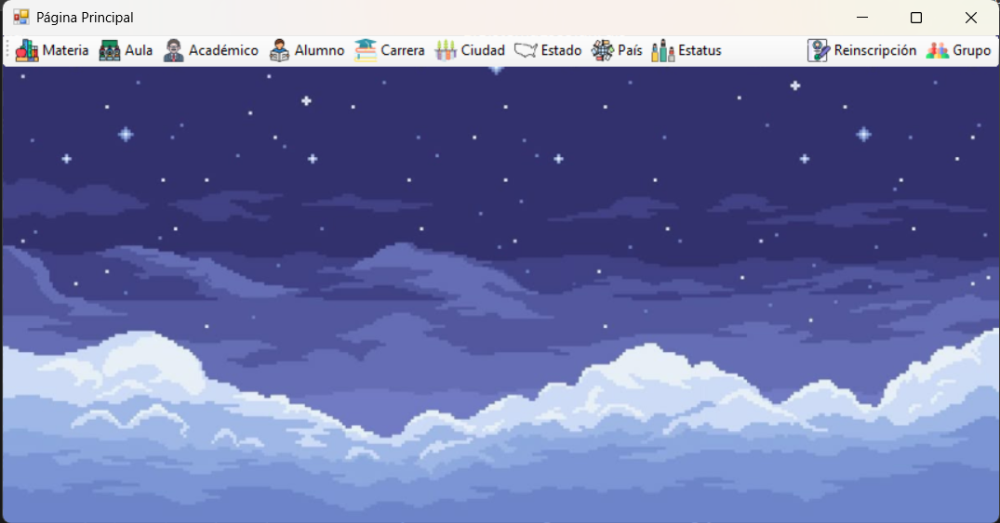
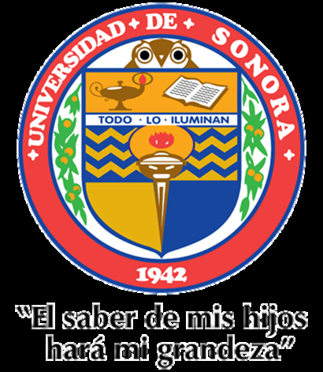
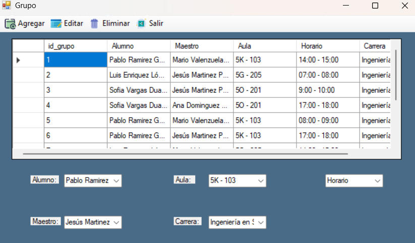
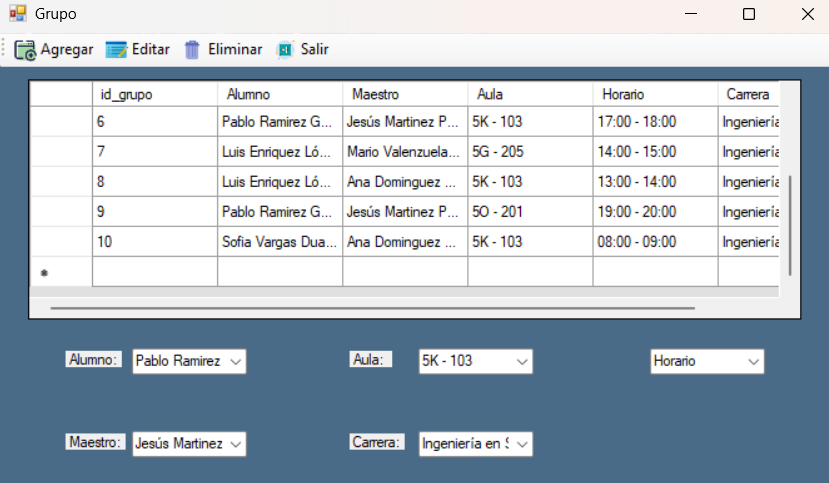
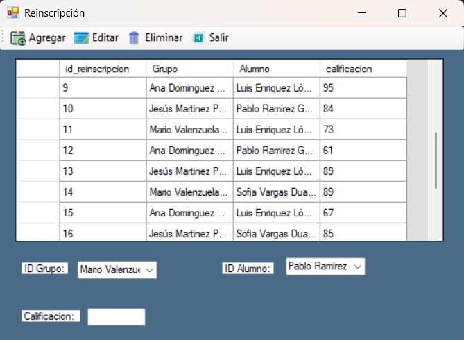
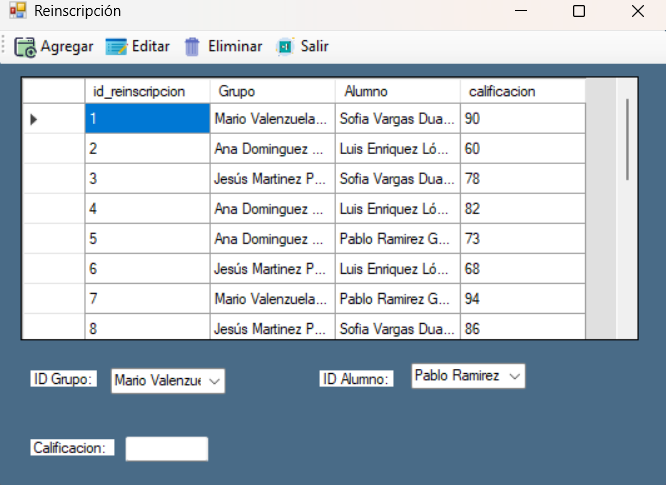
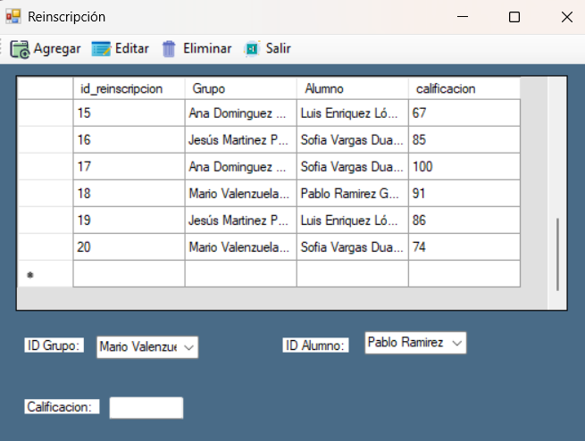
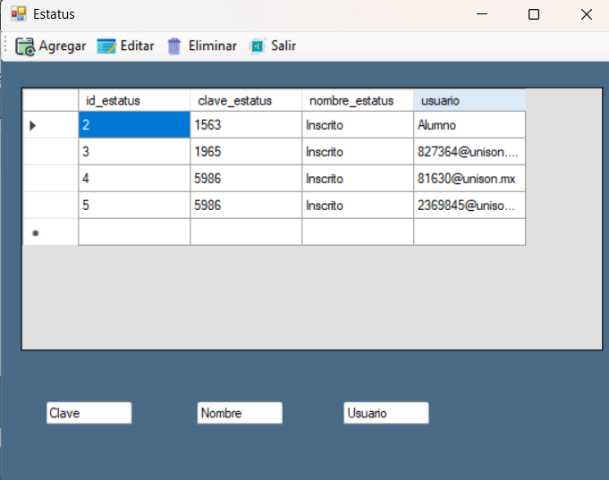

# SistemaEscolar

> **ES:** Sistema de gestión escolar de escritorio (C# / Windows Forms + SQL Server).
> **EN:** Desktop school management system (C# / Windows Forms + SQL Server).

---

## Español

### Descripción

Sistema de gestión escolar de escritorio desarrollado en **C# (Windows Forms)** sobre **.NET Framework
4.7.2**, con persistencia en **SQL Server**. Proyecto de la materia de Desarrollo de Sistemas III.

Dos grupos de módulos, cada uno contra su propia base de datos:

- **Catálogos** (`Catalogos`): País, Estado, Ciudad, Estatus, Carrera, Materia, Aula.
- **Tablas** (`Tablas`): Alumno, Grupo, Académico y Reinscripción.

Cada formulario implementa operaciones **CRUD** integradas con controles de Windows Forms
(`DataGridView`, `ComboBox`, `TextBox`), con validación de campos y manejo de eventos.

### Integrantes (creadores)

- David Antonio López Corella
- Daniela Sandoval López

**Materia:** Desarrollo de Sistemas III · **Maestro:** Lev David Valenzuela López · **Universidad de Sonora**

### Tecnologías

- C# · Windows Forms · .NET Framework 4.7.2 · SQL Server (Microsoft.Data.SqlClient) · Visual Studio 2022

### Requisitos y ejecución

1. Windows + [Visual Studio 2022](https://visualstudio.microsoft.com/) (carga "Desarrollo de escritorio con .NET").
2. [SQL Server Express](https://www.microsoft.com/sql-server/sql-server-downloads) con las bases **Catalogos** y **Tablas**.
3. Ajusta la cadena de conexión (`Server=localhost\SQLEXPRESS; ...`) al inicio de cada formulario.
4. Abre `SistemaEscolar.sln` y ejecuta con **F5**.

### Contenido

- `images/` — diagramas de la base de datos y capturas de la aplicación.

---

## English

### Description

Desktop school management system built in **C# (Windows Forms)** on **.NET Framework 4.7.2**, with
**SQL Server** persistence. A project for the Software Systems Development III course.

Two module groups, each backed by its own database:

- **Catalogs** (`Catalogos`): País, Estado, Ciudad, Estatus, Carrera, Materia, Aula.
- **Tables** (`Tablas`): Alumno, Grupo, Académico, Reinscripción.

Every form implements **CRUD** wired to Windows Forms controls (`DataGridView`, `ComboBox`, `TextBox`),
with field validation and event handling.

### Authors (creators)

- David Antonio López Corella
- Daniela Sandoval López

**Course:** Software Systems Development III · **Lecturer:** Lev David Valenzuela López · **University of Sonora**

### Tech

- C# · Windows Forms · .NET Framework 4.7.2 · SQL Server (Microsoft.Data.SqlClient) · Visual Studio 2022

### Requirements & run

1. Windows + [Visual Studio 2022](https://visualstudio.microsoft.com/) (".NET desktop development" workload).
2. [SQL Server Express](https://www.microsoft.com/sql-server/sql-server-downloads) with the **Catalogos** and **Tablas** databases.
3. Adjust the connection string (`Server=localhost\SQLEXPRESS; ...`) at the top of each form.
4. Open `SistemaEscolar.sln` and run with **F5**.

### Contents

- `images/` — database diagrams and application screenshots.

---

## Galería / Gallery

